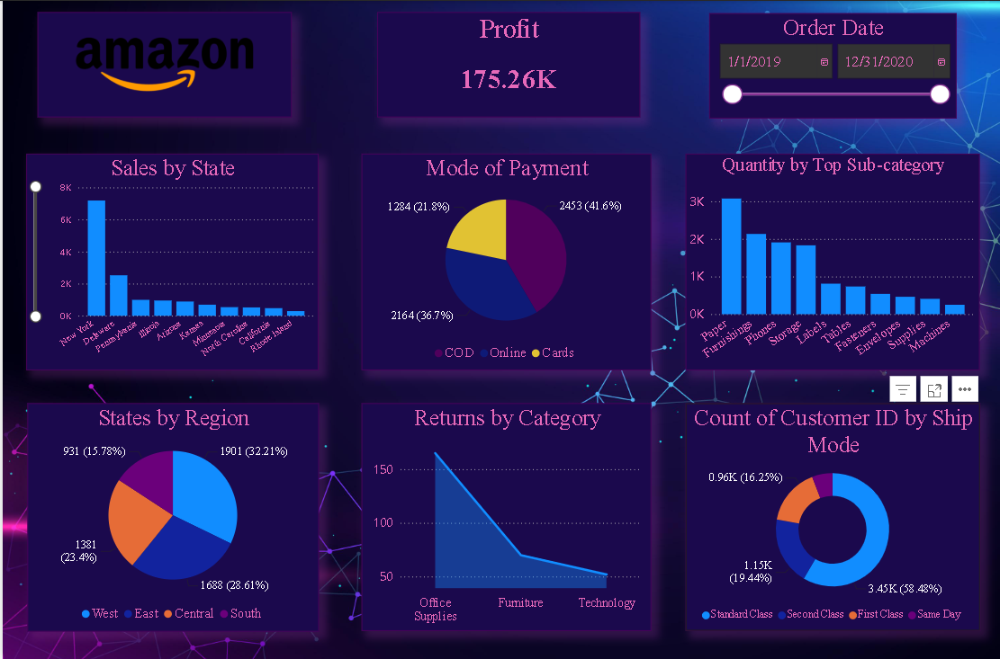

# Amazon Sales Analytics Dashboard | Power BI

## Project Overview

This project presents an interactive Amazon Sales Analytics Dashboard developed using Microsoft Power BI. It provides insights into sales performance, profitability, customer purchasing behavior, regional distribution, product demand, and order shipping preferences.

The dashboard helps understand business performance through interactive visualizations and data-driven reporting.

## Dashboard Preview



## Key Performance Indicators

- **Total Profit:** 175.26K
- **Order Date Range:** January 2019 – December 2020

## Dashboard Features

### 1. Sales by State
Analyzes sales distribution across different states to identify geographical sales patterns.

### 2. Mode of Payment
Visualizes the distribution of payment methods:
- Cash on Delivery (COD)
- Online Payments
- Cards

### 3. Quantity by Sub-category
Identifies product sub-categories based on quantity sold.

### 4. States by Region
Displays regional distribution across West, East, Central, and South.

### 5. Returns by Category
Analyzes product returns across different product categories.

### 6. Customer Count by Shipping Mode
Compares customer distribution across different shipping methods:
- Standard Class
- Second Class
- First Class
- Same Day

### 7. Interactive Date Filter
Allows users to analyze sales performance across the selected order date range.

## Tools & Technologies

- Microsoft Power BI
- Power Query
- DAX (Data Analysis Expressions)
- Data Visualization
- Data Cleaning and Transformation

## Dataset

- **Source:** Kaggle
- **Dataset:** Amazon Sales Dataset
- **Period:** 2019–2020

Original Kaggle dataset link: [Add the exact Kaggle dataset URL here]

Dataset attribution and licensing should be checked against the original Kaggle listing.

## Business Objectives

- Understand regional sales performance.
- Analyze payment method preferences.
- Identify high-demand product sub-categories.
- Monitor product returns.
- Evaluate shipping mode preferences.
- Support business decision-making through interactive reporting.

## How to View the Dashboard

1. Clone or download this repository.
2. Download and install Microsoft Power BI Desktop.
3. Open the `.pbix` file from the Dashboard folder.
4. Refresh the dataset if required.
5. Explore the interactive dashboard using filters and visualizations.

## Project Structure

```text
Amazon-Sales-Analytics/
│
├── Dashboard/
│   └── Amazon_Sales_Analytics.pbix
│
├── Dashboard_Screenshots/
│   └── Amazon_Dashboard.png
│
├── Documentation/
│
└── README.md
```

## Author

**Nilesh R. Harijan**

Computer Engineering Graduate | Aspiring Data Analyst

Skills: Power BI | SQL | Excel | Python | Data Analytics

---

*This project was developed for learning, portfolio development, and practical business intelligence analysis.*
